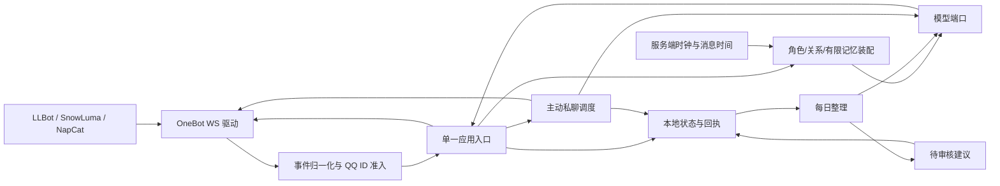

# AlwaysBack 项目设计与需求对照

## 目标与边界

以单个用户 QQ 号为中心，提供可配置角色的长期对话服务。角色人格、关系、记忆和用户画像分别存储；模型负责生成候选内容，用户负责批准会改变长期状态的候选。第一阶段只接 OneBot v11 正向 WebSocket，部署在单机上。

本项目把“陪伴”定义成角色一致、尊重边界、能够纠错的对话体验。不会根据聊天推断心理缺失或诊断疾病，也不会用推断出的脆弱性增强依赖。用户明确提出的支持方式可以在单独同意后记录。

## 六项需求逐项设计

| 需求条目 | 用户路径与数据流 | 当前骨架 | 验收条件与下一步 |
| --- | --- | --- | --- |
| 1. 初始设定角色卡 | 用户提供基础 JSON → 模型检查缺失/冲突并追问 → 用户填写答案 → 模型整理 → 激活版本。角色卡字段分为背景、人格、语气、价值观、边界和关系风格。 | `persona start/finalize` 已实现；草稿和激活版分开，修订号递增。 | 用多个缺字段、冲突字段和拒绝回答的样本人工验收问题质量；补可视化编辑器与字段级差异审核。不得把模型补造内容当用户设定。 |
| 2. 设置初始状态 | 用户显式选择 `stranger/friend/partner`，作为生成上下文；模型不得自行改关系阶段。 | `relationship set` 已实现并审计。 | 检查不同初始关系下的对话差异与越界样本；后续提供自定义关系文本与用户确认的关系变更记录。 |
| 3. 分析对话数据，默认关闭 | 单独告知并显式授权 → 每日读取近期私聊 → 模型提出角色卡调整、记忆候选、类别和来源 → 人工审核后应用。 | 许可闸门、每日任务、来源消息 ID 和时间、待审核建议和角色/记忆写入已实现；无新对话则跳过重复分析。 | 下一阶段补记忆合并、冲突处理、按主题/时间检索、保留期限及逐条更正/撤回；用真实长对话人工评估提取准确率。 |
| 4. 用户画像，默认关闭 | 独立告知范围、用途、模型服务和删除方式 → 单独授权 → 仅从用户明确表达的内容提取称呼、沟通偏好、兴趣、边界、支持方式 → 人工审核 → 只在私聊注入。 | 独立许可、审核、撤销后停止注入及删除命令已实现；排除诊断、脆弱性推断与操控目的。 | 补逐条查看/更正/删除界面、来源消息引用、保留期限；人工审查错判率和误用风险。 |
| 5. 聊天平台接入 | LLBot、SnowLuma、NapCat 配置为 OneBot v11 正向 WS；统一事件归一化、回执、重连、超时和发送端口。 | 通用 OneBot 客户端已实现；文本私聊和白名单群聊入口已接通至核心；群聊按需调用 `get_group_msg_history` 并限量装配上下文。 | LLBot 群历史读取与格式化已做只读探测；新版本仍需真实群聊回复验收。SnowLuma、NapCat 分别测试历史接口、接收、回执和重连。语音、反向 WS 与扩展动作尚未实现。 |
| 6. 用户身份鉴别 | 私聊只允许 `ownerQq`；群聊允许白名单群内任意成员明确 `@botQq`，或在文字段中写出配置的点名词。用事件 `user_id/self_id` 校验，若 `sender.user_id` 存在须一致。昵称、群名片永不参与鉴权。 | 入口校验和单元测试已实现；群聊不携带私密上下文。 | 在真实 QQ 群验证非授权成员 `@` 和文字点名、未触发的消息、他人冒名与重复事件。QQ 号只证明协议端报告的账号，不替代 QQ 平台登录安全。 |

## 架构

- `src/onebot.mjs` 只处理 OneBot 协议。事件输入为不可信数据，先校验身份与消息段，再进入应用；发送用 `echo` 对应回执，超时/断线的结果标为未知，不重发。
- `src/app.mjs` 是单一编排入口。私聊取有限历史、已批准记忆和已批准画像；群聊取公开角色字段、当前消息及本群近期历史。一次收件先登记消息 ID，再生成、发送、登记回执。
- `src/time-context.mjs` 为普通私聊、群聊和主动私聊生成统一的北京时间上下文。稳定的时间使用说明放在 system 提示，随请求变化的时间值放在 user JSON，避免每分钟改写 system 提示。
- `src/group-context.mjs` 通过 OneBot 按需读取群历史，仅保留同群、当前消息以前、12 小时内的最多 24 条（可配置为 1–40）。按时间与序号排序，标注发言者和窗口内引用；媒体只给类型占位。每条正文最多 320 字、总量最多 6000 字。历史接口失败时记录审计并向模型明确标记缺失，不能假装知道早前对话。
- `src/proactive.mjs` 管理唯一授权用户的主动私聊。持久化开关、下一次计划、最近尝试和未回复次数；以最近私聊为前提，采用随机间隔、免打扰、空闲、日上限和未回复停发闸门。过期计划不补发，发送尝试先计入预算以免回执不明时重复外发；收到 QQ 回执的内容进入同一私聊历史。模型可跳过本轮，不能自行扩大收件人或发送频率。
- `src/persona.mjs` 维护角色卡草稿与激活版本。`src/analysis.mjs` 只产生候选，长期状态只有用户审核命令能修改。
- 群聊角色资料由 `publicPersona` 从角色卡提取。原先整段排除“人物关系（记忆锚点）”使授权用户的关系设定也丢失；现在可用 `groupPersona.publicOwnerRelationship` 显式公开经审核的描述，原始关系章节仍不直接进入群聊。配置必须指定适用的显式关系状态，状态不匹配时不注入。群模型仍看不到 owner QQ、私聊历史、画像和未公开的亲密细节；群昵称不能证明发言者就是 owner。
- `src/store.mjs` 是当前唯一状态源。写操作有锁和原子替换；后续数据量增加时可迁移 SQLite，并保留当前服务接口。
- `src/model.mjs` 接 Chat Completions 兼容接口。不同服务的 JSON 模式和输出质量须单独验证；模型不可直接决定身份、许可或外发权限。

## 全群观察实现

`src/onebot.mjs` 对同一原始事件分别运行原有回复准入与 `normalizeObservation`。观察校验机器人、群、发送者、消息 ID 和最近 24 小时时间，只提取文字与媒体类型。普通群消息进入 `src/group-observation.mjs` 的有界队列并批量写入本地状态；不会触发取图、群历史或即时模型调用。`groupIds` 和点名条件继续只控制群回复。

观察与远端分析为 `state.groupObservation.enabled`、`remoteAnalysisEnabled` 两个默认关闭的状态开关，均须通过带告知的 CLI 单独启用。旧状态迁移时新增状态为关闭。`config.json` 的 `groupObservation.excludedGroupIds` 排除群，其他配置限制容量、保留期限、轮次和日预算。原始文字按群限量、最长保存 24 小时；想法最长 30 天。清除群会删掉所有引用该群的想法；关闭远端分析清理想法，关闭观察还清理原始缓冲。清理或撤销会使正在处理的观察批次失效。

批量任务每轮从未分析消息按群取有限条数和字符数，先预留调用及保守 token 估算预算，再请求模型。`src/model.mjs` 传递 `max_tokens` 并暴露服务商 `usage`；缺少用量时保留输入字符数加输出上限的估算收费。模型输出必须是结构化短期想法并引用本轮真实消息 ID，否则拒绝。引用只能证明群中出现过讨论，不能自动核实模型总结与外部事实；真实内容仍需人工评估。预算或模型失败会记录原因，不逐条重试，也不把旧缓冲留到下一日等待外传。

只有当前有效的少量想法进入 owner 私聊与主动私聊候选；它们标记为 `inferred`，不改变关系、画像或稳定人格。主动消息仍由原有关系、七日私聊、空闲、免打扰、未回复与日上限控制；生成后与发送前会复验想法是否仍有效。群回复不注入任何观察想法。未实现群主动发言、群成员私信、从群聊推断心理或外部平台操作。实际 OneBot 是否推送所有已加入群消息需要实机核验；本地测试只能证明收到的模拟事件被正确处理。

曾用带令牌的只读 `group-observation probe-feed` 对 LLBot 做短时探测，仅观察到部分已加入群有普通文字事件。其余群可能当时没有发言，因此全群推送覆盖仍未证实。探测未读取群历史、保存正文或发送 QQ 消息。

## 时间上下文的数据流与边界

1. 普通消息经 OneBot 归一化后，在装配模型请求时读取服务端时钟；主动私聊使用本次调度的时刻。统一使用 `Asia/Shanghai`，不依赖操作系统配置的显示时区。
2. `timeContext` 始终包含北京时间 `now`（到分钟）、中文 `weekday` 和 ISO 格式 `nowUtc`。若本次提供的历史中有可解析的最后一条 `at`，并且不晚于当前时刻，附上 `minutesSinceLastMessage`。此间隔只表示模型看到的最后一条历史消息，不能当作“用户上次回复时间”。
3. 普通消息的 OneBot `time` 只在当前时刻前 7 天至后 5 分钟内转换为 `currentMessageAt`；超出范围则省略。私聊入库时，可信的平台时间作为用户消息 `at`，否则使用服务端时间。群历史仍由 `src/group-context.mjs` 按同群、先后顺序和 12 小时窗口过滤；历史读取失败不影响当前时间字段。
4. 模型收到明确指令：回答相对日期与时间问题时以 `timeContext` 为准，历史 `at` 不等于现在，聊天内容和角色卡里的日期不能覆盖服务端时间；无需谈时间时保持自然对话。时间数据不提供天气、日程或用户实时状态，模型也不得据此编造。

该功能依赖主机系统时钟准确，未实现联网校时或生成结果的日期校验。固定时钟的本地测试覆盖三种生成路径及私聊入库时间；真实 QQ 对话还需人工询问日期、星期和时间来观察模型表现。时间值位于 user JSON，system 提示保持稳定，但实际缓存命中率仍由模型服务商实现、角色卡和请求内容决定，不能从代码推断。

## 主动联系的验收边界

主动能力是用户追加的需求，仅触达配置中的唯一授权 QQ 私聊。`proactive enable|disable|status` 管理本机持久化开关。主动频率只由用户显式选择的关系状态决定，配置中可逐档检查和编辑：`stranger` 停发；`friend` 随机间隔 4–8 小时、空闲 90 分钟、滚动 24 小时最多 2 次；`partner` 随机间隔 2–4 小时、空闲 60 分钟、滚动 24 小时最多 3 次。关系变动会使旧计划失效，不由模型或画像推断关系。共同闸门为北京时间 23:00–08:00 免打扰、连续 2 次未获私聊回复停发；无近期私聊、服务离线或错过时间槽时不补发。主动模型请求用完整私聊人格及最近 12 条私聊、已批准记忆/画像；它可跳过但无权选择收件人或放宽限额。验收必须分别核对真实 QQ 收件、OneBot 回执、持久化历史、模型输出的人格一致性；本地模拟测试不代表真实主动联系已发生。

## 数据边界与保留

`data/state.json` 保存 owner QQ、角色卡、初始关系、私聊分析许可、群观察与远端分析开关、主动联系的开关与计划、最近私聊正文、已批准记忆和画像、附有来源消息 ID/时间/短摘录的建议、收发状态及审计日志。当前私聊正文保留最近 `historyLimit × 4` 条，审计保留最近 300 条；已批准记忆与画像没有自动过期，需用管理命令删除。关闭群观察时群聊正文不落库；开启后只保留限量短期观察缓冲。对话分析与画像使用近期最多 40 条私聊记录；不从群聊提取画像。

当前磁盘内容未加密。部署者应限制目录访问；云模型会收到被送入请求的角色卡、当前私聊及有限历史，启用分析后还会收到用于整理的私聊正文。触发群聊回复时，云模型还会收到公开人格、当前消息和按上述规则截取的群成员历史消息；群正文不落本地状态库。未来需要数据导出、逐条删除、加密备份、密钥轮换和删除传播机制，才能作为多人或托管服务使用。

## 设计取舍

- 角色、关系、记忆与画像分开持久化；模型生成的长期状态变更先进入人工审核。
- 群聊回复仅使用本群历史和显式公开的人格资料；群观察另走独立授权与有界缓冲。
- 主动私聊使用持久化排期、免打扰、未回复停发和发送回执；只触达配置中的唯一授权用户。
- 协议层与上下文层分离，模型输入与本地存储均设置长度和数量边界。

## 迭代顺序

1. **当前骨架**：六项需求都有路径和状态，完成本地合成测试与 CLI 操作。
2. **真实协议端验收**：分别使用 LLBot、SnowLuma、NapCat 进行接收、发送回执、断线与群聊权限测试，并记录各自版本及差异。
3. **记忆与管理体验**：增加审核页面、来源引用、逐条修改/删除、记忆合并和检索，避免长期累积后只取最新八条。
4. **体验评估**：固定同一模型、相同对话集，对比角色一致性、记忆准确率、越界率与用户主观体验。只有测试后才能声称实际陪伴效果改善。

## 验收口径

`node --test` 只证明模块在模拟模型/发送端与本地 WebSocket 协议端下满足局部行为。`doctor` 只证明本地配置可解析。要宣称可在某个协议端使用，需要真实 QQ 账号与该协议端的收发回执；要宣称人格或画像达到预期，需要人工样本评估。错误、超时与未授权状态必须按原状报告。

## 协议依据

OneBot v11 的[消息事件字段](https://github.com/botuniverse/onebot-11/blob/master/event/message.md)规定了 `self_id`、`user_id`、`group_id` 和 `sender` 的位置。三种协议端都提供 OneBot 正向 WS 配置入口：[LLBot](https://luckylillia.com/guide/config)、[SnowLuma](https://snowluma.github.io/en/docs/guide/connect-bot)、[NapCat](https://napneko.github.io/NapCatQQ-Desktop/docs/connections/)。这些文档只能证明预期协议接口，实际兼容仍需各端测试。
