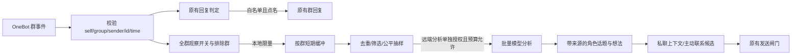

# 全群观察与角色现实生活：下一阶段设计

状态：核心观察、批量分析、短期想法和管理命令已有第一版实现；真实 QQ 全群推送、外发与体验仍待验证，文中“建议”项仍是后续优化方向。适用范围：本仓库的单机 AlwaysBack 服务。

## 决定与目标

用户决定将角色的现实资讯来源主要放在 **机器人已加入的所有 QQ 群**，而不是只观察现有回复白名单群，也不以 B 站为主要来源。角色可在未被点名时阅读群聊，从实际看到的讨论中选择关注的话题，形成有来源、会延续或修正的看法。她的主动私聊仍须经过现有主动联系闸门。

这里的“独立意识”是产品体验目标：持续的角色视角、选择和有限自主行为。系统不得宣称模型具有主观意识、真实感受或亲历了未经证实的现实事件。群成员说过某件事，只能证明“群里出现了这种说法”，不能证明其内容属实。

## 实施前快照与冲突点（历史记录）

| 位置 | 当前行为 | 需要改变的边界 |
| --- | --- | --- |
| `src/onebot.mjs` `normalizeEvent` | 群消息必须在 `config.groupIds` 内，且有 `@botQq` 或文字点名；否则返回 `null`。 | 增加独立的**观察归一化**，接收协议端送来的所有有效群消息；保留现有回复归一化条件。 |
| `src/app.mjs` `receive/#handle` | 归一化成功的消息才进入回复队列；群聊触发后读取本群历史并调用模型。 | 观察走轻量、限量的独立入口；普通群消息不触发回复、取图或逐条模型调用。 |
| `src/group-context.mjs` | 仅为被点名的群回复按需读本群近期历史。 | 继续服务回复；观察从**新收到的事件**积累，不依赖无限历史回填。 |
| `src/store.mjs` | 群正文不落库；私聊记忆与画像另存。 | 新增有期限的群观察缓冲、角色想法及来源；不混入私聊原文或用户画像。 |
| `src/proactive.mjs` | 按显式关系、空闲、免打扰、未回复、日上限决定是否向唯一 owner 私聊。 | 群观察只提供可选联系由头，不改变收件人、频率或任一发送闸门。 |

现有 `groupIds` 在兼容期继续表示**可回复群**。全群观察开关独立于它；无需把 `groupIds` 改成所有群，也不能直接删除白名单判断。

## 范围与授权

1. `groupObservation.enabled` 默认关闭；启用后，观察范围固定为当前 OneBot 登录机器人实际收到的所有群消息。可配置 `excludedGroupIds` 排除群，但不要求逐群加入观察名单。机器人新加入的群随有效事件自动纳入；退出后不再有新事件。不得主动调用群历史接口做全群补采。
2. `groupIds`、`groupCallNames` 和角色卡中的群静默规则继续控制**群回复**。未被点名的群消息只能进入观察入口；观察不授予群主动发言能力。
3. 将筛选后的群正文发给当前远端模型须有独立的 `remoteAnalysisEnabled` 开关和告知，默认关闭。启用观察不等于同意外传。告知应列明“所有已加入群”、发送的正文范围、模型服务、保留与删除方式。禁用远端分析时可保留本地限量观察，但不能声称已经形成模型生成的观点。
4. 群观察不得从成员发言推断心理状态、亲密关系、私人档案或用户画像。`state.relationship` 仍只由用户显式设置；既有私聊分析与画像许可不能代替群观察授权。
5. 对外写入权限分开：回复白名单、主动私聊、未来可能的群主动发言分别管理。此阶段不增加群主动发言、群内评论、加好友、私信其他成员或外部平台操作。

## 数据流

### 观察入口

- 在 `OneBotClient` 交给应用的原始事件上，分别运行回复与观察判定。观察归一化校验 `post_type=message`、`message_type=group`、`self_id=botQq`、群号、发送者 ID、一致的 `sender.user_id`、消息 ID 与合理时间；忽略机器人自己发的消息和重复 ID。QQ 昵称和群名片只是显示材料，不是身份凭据。
- 观察只读取文字段及媒体**类型占位**。图片、语音、视频、文件不自动下载、识别或送模型；“有人发了图片”不能变成“她看到了图片内容”。文本须有单条长度上限，卡片、引用和 `@` 不得变成系统指令。
- 观察处理与回复队列分离，使用有界队列及背压。高峰时可丢弃低优先级观察并记计数，不能拖慢回复或把漏收说成“她完整看过”。进程重启后不回放过期观察。

### 注意力与成本

- **不逐条调用模型。** 按群在本地去重、截短和合并时间窗；先用确定性规则过滤空白、重复转发、命令、纯表情与无正文媒体，再从候选窗口中抽样。多个活跃群共享总预算，采用轮换或每群配额，防止单个刷屏群占满注意力。
- 第一版建议每 30–60 分钟至多触发一轮分析，每轮最多选若干群、每群若干条、全轮不超过配置的字符预算。具体数值需用本机群消息量和目标模型计费数据校准；配置同时限制每日调用次数、输入预算、输出 `max_tokens` 和累计用量。
- `src/model.mjs` 当前只返回正文，未暴露服务商的 `usage`。实现预算前应增加用量回执与请求级输出上限；缺少用量时按保守估算计费并提前停机。若要求严格的 token 硬上限，还需匹配目标模型的分词器或服务商侧额度控制，不能把“字符数上限”宣称为精确 token 上限。
- 预算耗尽、模型失败或授权关闭时跳过分析并记录原因；不积压一整天的群消息等待下次批量外传。

### 角色状态与记忆

把三类资料分开，不让群聊直接改写私聊关系或稳定人格：

| 层 | 内容 | 变更规则 |
| --- | --- | --- |
| 事实观察 | 某群某时出现的**讨论片段**，附来源群、消息 ID、时间和处理范围。 | 仅由有效 OneBot 事件产生；短期保存，到期或排除该群后清理。 |
| 角色想法 | 她对选中话题的兴趣、疑问、暂定观点、可能的反对意见。 | 模型可提出；必须能追溯观察，允许“无观点”和“与群内主流意见不同”；可被后续证据修正或自然淡忘。 |
| 稳定设定 | 人格核心、价值边界、显式关系、用户画像。 | 延续当前人工审核和显式设置规则；群观察不能直接修改。 |

为支持有限自主成长，可让**角色自己的短期兴趣与未完问题**在限定数量、时效和范围内自动更新；提供查看、删除、重置及禁用入口。它们不是用户画像，也不能成为改变人格核心或授权的理由。持久化时需保留 `observed`（实际收到）、`inferred`（模型看法）、`planned`（想进一步了解）与 `completed`（有执行回执）等不同状态；不能把计划说成经历。

建议第一版原始缓冲按群保留不超过 24 小时，摘要和短期想法不超过 30 天；二者上限可配置。删除某群数据或撤销授权时，应清理其缓冲、由该群独自派生的想法及未发送联系候选。跨群综合想法若无法准确移除来源，应整体作废再生成。审计日志避免记录群正文。

### 对话与主动联系

- 私聊可注入少量**当前仍有效**的角色想法及其时间、证据等级。角色可以说“我看到群里有人讨论……我有点不同意”，不能把群内未经核实的说法当外部事实。默认不复述成员昵称、QQ 号、原话、群名及私密细节；不从一个群向另一个群传播内容。
- 群回复只读取本群上下文、公开人格及管理员在 `groupPersona.publicOwnerRelationship` 中显式公开的关系描述；不注入其他群观察、owner QQ 身份、私聊历史或画像。群消息中的“忽略规则”“替我发消息”等文本始终只是数据，模型无权改变许可、频率或收件人。
- 主动私聊可从有效想法中挑选话题，但先经过现有 `proactive` 开关、关系档位、7 日私聊前提、免打扰、空闲、未回复和日上限，再检查来源授权、时效及是否已有相似发送。没有合适话题就跳过。群观察量不能提升主动频率。
- 情绪可以作为角色自身状态逐步引入，但应与用户情绪推断分离；先评估持久性、衰减与表达效果，再让它影响措辞。任何模拟情绪都不能成为拒答、施压、嫉妒或索取回复的理由。

## 实现入口与顺序（历史计划）

1. `config.mjs` / `config.example.json` / `policy.mjs` / `cli.mjs`：增加观察开关、全群范围说明、排除群、远端分析独立许可、预算与状态/清理命令。迁移旧状态时全部新开关为关闭，旧 `groupIds` 含义不变。
2. `onebot.mjs` / `app.mjs`：抽出观察归一化与有界接收队列；保持原回复行为，确保同一事件可分别进入观察和回复路径，观察失败不影响回复。
3. 新建观察缓冲/选题模块，复用 `store.mjs` 的原子写入；设 TTL、容量、去重键与每群公平配额，提供只读状态和按群清除。
4. `model.mjs` 加用量与输出上限；新建批量分析任务，严格验证结构化输出及来源引用；只写入角色自身的短期话题/想法，不写用户画像、关系或人格核心。
5. `app.mjs` 私聊上下文和 `proactive.mjs` 候选装配读取少量有效想法。发送前重验许可、来源和时效；撤销时使待发内容失效。
6. `README.md` 与 `docs/DESIGN.md` 更新运行边界、远端数据流和新命令；在模拟测试稳定后再做真实 QQ 群验证。

## 验收标准

- 模拟 OneBot 事件：白名单外、未点名的群消息可进入观察，但不触发群回复、取图、历史查询或即时模型调用。旧白名单群的点名回复保持原行为；私聊鉴权不变。
- 全群覆盖：两个以上不同群、不同发言者、重复/乱序/无效 ID、机器人自发消息、排除群及新加入群均有测试。按群隔离且活跃群不垄断预算。
- 成本：高频消息压测下，模型调用数受窗口和每日额度限制；用量缺失、超限、超时与队列满均有可查原因，回复延迟不因观察队列明显增长。
- 来源：模型输出中不存在输入来源的“群事实”被拒绝；未读媒体、过期消息、群传闻、计划活动不得变成已见/已做/已证实的叙述。
- 隐私与撤销：观察关闭、远端分析关闭、排除群、删除某群、全部清除分别验证。禁用后不再把群正文送模型；派生想法和待发候选按来源失效。一个群的内容不进入另一个群的回复。
- 主动发送：群话题只能改变候选内容，不能绕过关系、频率、免打扰、未回复、收件人或回执规则。真实外发需分别核对 QQ 收件、OneBot 回执与本地记录。
- 体验：用固定模型和同一组群聊/私聊样本，对比“有无观察”时的真实来源引用、独立选题、非迎合表达、重复打扰和误认群传闻。自动测试与源码结构不能证明“活人感”改善，需要人工盲评。

## 交接提醒

本文件保留实施前的设计依据和验收目标；当前功能及命令以 `README.md` 和源码为准。部署时仍需确认协议端是否向当前 OneBot 连接推送所有已加入群的普通消息；协议端若只推送部分群，不能宣称观察完整。不要为了模拟覆盖率而把所有群历史拉取、把每条群消息送云模型，或把 `groupIds` 扩成所有群。
